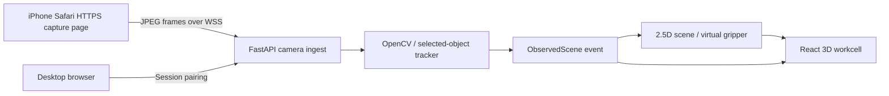
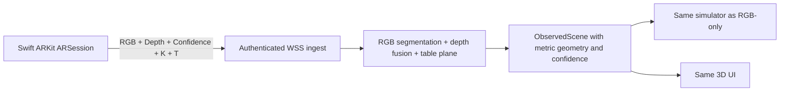
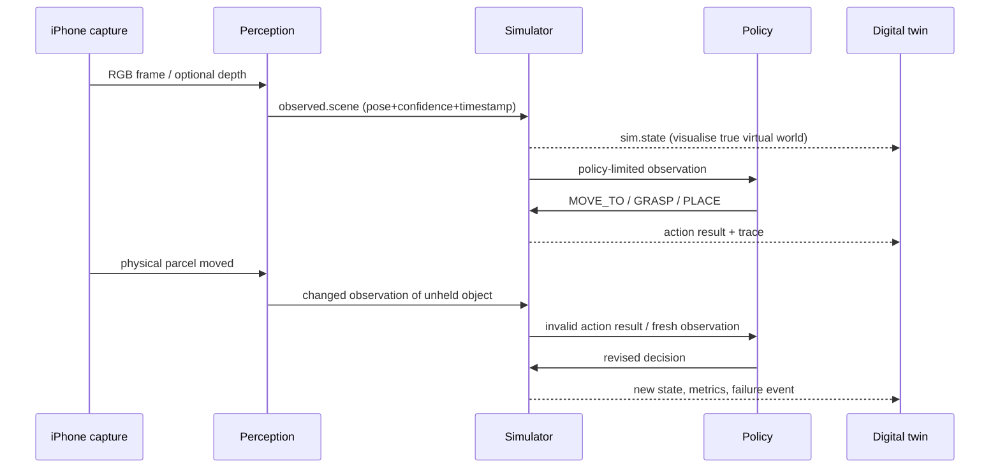

# FAULTLINE Camera & iPhone LiDAR — Practical Integration Guide

**For:** Camera/frontend engineers, iOS engineer (optional), simulation engineer  
**Updated:** 17 October 2026  
**Primary design choice:** **RGB camera first; native iPhone LiDAR second.** Both output exactly the same scene-state schema.

---

## 1. Short answer

**Yes, a compatible LiDAR iPhone can deliver real depth estimates in metres and camera calibration through native Apple ARKit.** It can help estimate approximate object position above the table, height, obstacle proximity and a better 3D digital twin.

**No, an ordinary Safari web app using `getUserMedia()` does not expose ARKit rear-LiDAR `sceneDepth` as a normal video track.** Safari/web `getUserMedia()` is the quickest **RGB-only** path. If depth is required, make a small **Swift + ARKit companion application** with its own sensor streaming protocol.

**Recommendation today:** Build a robust browser capture flow while someone separately timeboxes a native ARKit feasibility spike. The simulator and UI must treat depth as optional. No special stickers/markers on real objects.

## 2. Which iPhone and software prerequisites?

- A **LiDAR-capable iPhone Pro/Pro Max or supported iPad Pro**, confirmed by calling `ARWorldTrackingConfiguration.supportsFrameSemantics(.sceneDepth)` at runtime. Not all iPhones have the scanner.
- Xcode on a Mac, code signing to an actual physical iPhone, permission strings in Info.plist (at minimum camera; local network if using LAN discovery/access as needed).
- If native build/signing proves difficult, immediately use the HTTPS browser capture page or Mac's built-in webcam.
- Camera should be securely mounted, with objects in full view, reasonable stable illumination, and textured nonreflective background. **Transparent bottles, shiny wrappers and thin pens may have poor depth samples.**

Depth values are **estimates**, not precision metrology. ARKit's `depthMap` values are in metres and a `confidenceMap` indicates uncertain samples. Depth maps are often lower resolution than RGB. Fixed camera, measured work surface and human-in-the-loop dimension corrections are sensible.

## 3. Integration topology options

### Route A — Browser RGB (mandatory first)



**Flow:**

1. Desktop app creates `camera_session_id` and short, expiring **pair code**. Display an HTTPS URL/QR *on the desktop screen*; no markers are needed on any physical object.
2. iPhone opens capture page, enters/accepts pair code, taps Start Camera and authorises camera access.
3. Page previews video and transmits resized, compressed RGB JPEG frames, initially ~5 frames/s at 640×480. The browser sends explicit seq/timestamps and applies backpressure (drop frames when connection lags).
4. Backend consumes frames, tracks selected objects (e.g., chocolate bar, carton, highlighter), publishes structured observed scene.
5. Desktop subscribes to live `observed.scene` events, rendering 3D parcels while backend keeps simulator state separate.
6. If Wi-Fi/tunnel fails, laptop webcam uses the same ingest/tracker path.

**Critical web requirement:** Camera `getUserMedia()` needs a secure context (typically HTTPS; localhost on the same device is a special case). `http://192.168.x.x:...` from the iPhone generally is *not* a secure context. For phone browser use properly trusted HTTPS + WSS, e.g. a trusted tunnel or simple secure deployment. Do not assume LAN HTTP will work.

**Browser pseudo-implementation:**

```javascript
const media = await navigator.mediaDevices.getUserMedia({
  video: { facingMode: { ideal: 'environment' },
           width: { ideal: 640 }, height: { ideal: 480 } },
  audio: false
});
video.srcObject = media;
await video.play();

const ws = new WebSocket(`wss://${HOST}/ws/camera/${SESSION_TOKEN}`);
const canvas = document.createElement('canvas');
canvas.width = 640;
canvas.height = 480;
const ctx = canvas.getContext('2d');
let seq = 0, busy = false;

async function sendFrame() {
  if (busy || ws.readyState !== WebSocket.OPEN || ws.bufferedAmount > 100_000) return;
  busy = true;
  try {
    ctx.drawImage(video, 0, 0, canvas.width, canvas.height);
    const blob = await new Promise(resolve => canvas.toBlob(resolve, 'image/jpeg', 0.72));
    if (!blob) return;
    const id = ++seq;
    ws.send(JSON.stringify({
      kind: 'camera.frame_meta', seq: id, timestamp_ms: performance.now(),
      width: canvas.width, height: canvas.height, bytes: blob.size
    }));
    ws.send(await blob.arrayBuffer());
  } finally { busy = false; }
}
setInterval(sendFrame, 200); // approx 5 Hz; tune empirically
```

This is illustrative, not complete production code. Use server-verified session tokens, message-size limits, connection cleanup and a robust metadata-to-binary pairing protocol. If the camera frames are sent over a public tunnel, keep the desk/participants' privacy in mind and do not expose long-lived credentials.

### Route B — Native ARKit RGB+LiDAR (optional)



**Required data from a single `ARFrame`:**

- `frame.capturedImage` — RGB/YUV camera pixel buffer.
- `frame.sceneDepth?.depthMap` — rear LiDAR depth estimates in **metres** on supported devices/configurations; `smoothedSceneDepth` optional visual smoothing.
- `frame.sceneDepth?.confidenceMap` — per-depth-pixel quality label (may be optional).
- `frame.camera.intrinsics` — 3×3 image camera matrix `K`.
- `frame.camera.transform` — camera pose / transform to the AR world coordinate system.
- `frame.timestamp`, camera tracking status, original image and depth buffer sizes, orientation/transform metadata.

**Minimal native ARKit outline:**

```swift
import ARKit

final class SensorBridge: NSObject, ARSessionDelegate {
    let session = ARSession()

    func start() {
        let config = ARWorldTrackingConfiguration()
        if ARWorldTrackingConfiguration.supportsFrameSemantics(.sceneDepth) {
            config.frameSemantics.insert(.sceneDepth)
        }
        if ARWorldTrackingConfiguration.supportsFrameSemantics(.smoothedSceneDepth) {
            config.frameSemantics.insert(.smoothedSceneDepth)
        }
        session.delegate = self
        session.run(config)
    }

    func session(_ session: ARSession, didUpdate frame: ARFrame) {
        let rgbBuffer = frame.capturedImage
        let depth = frame.sceneDepth ?? frame.smoothedSceneDepth
        let depthBuffer = depth?.depthMap
        let confidenceBuffer = depth?.confidenceMap
        let intrinsics = frame.camera.intrinsics
        let cameraToWorld = frame.camera.transform
        let captureTime = frame.timestamp
        // Encode/downsample RGB; pack depth data or selected depth samples;
        // include actual buffer sizes and camera calibration; send to backend.
        // Do not send uncompressed full-resolution depth + RGB every frame.
        _ = (rgbBuffer, depthBuffer, confidenceBuffer, intrinsics, cameraToWorld, captureTime)
    }
}
```

**Swift note:** This code illustrates ARKit acquisition, not a complete iOS app, transport implementation or calibrated RGB-depth fusion. You still need to implement permissions, UI/connection, image and depth encoding, coordinate alignment, throttling and device testing. `sceneDepth` may be `nil` if unsupported or temporarily unavailable.

### Native payload format (illustrative)

```json
{
  "kind": "sensor.rgbd_frame",
  "camera_session": "cam_001",
  "seq": 157,
  "ar_timestamp_s": 456.710,
  "source": "iphone_arkit_rgbd",
  "rgb": {
    "binary_ref": "jpeg_packet_157",
    "width": 1280,
    "height": 720,
    "orientation": "landscape_right"
  },
  "depth": {
    "binary_ref": "depth_packet_157",
    "width": 256,
    "height": 192,
    "encoding": "float32_m_downsampled",
    "confidence_ref": "confidence_packet_157"
  },
  "intrinsics_3x3": [[900,0,640],[0,900,360],[0,0,1]],
  "T_world_from_camera_row_major_4x4": [
    1,0,0,0,
    0,1,0,0,
    0,0,1,0,
    0,0,0,1
  ],
  "tracking_quality": "normal"
}
```

All numeric values are **examples**. The buffer and intrinsic scale/orientation must match. ARKit's transforms are typed matrices; choose explicit row-major or column-major wire representation and test it. Do not use example values as actual sensor calibration.

---

## 4. How LiDAR estimates 3D position and object dimensions

**Depth pipeline:**

1. Establish AR world tracking and identify a stable tabletop plane. Fit a plane to depth-supported points (robust plane fit/RANSAC) or select workplane in a guided setup.
2. Detect/segment selected objects in RGB frame; map object mask to depth pixel coordinates using correctly transformed camera calibration and image orientation.
3. Reject invalid depth and low-confidence samples. For each valid depth point at image pixel `(u,v)`, approximate its position in the **camera frame** using camera intrinsics:

   `X = (u-cx)*Z/fx`, `Y = (v-cy)*Z/fy`, `Z = depth_m`

4. Apply the calibrated `T_world_from_camera` transform (after accounting for Apple's AR coordinate conventions/image orientation) to obtain world coordinates.
5. Project object points relative to the table plane: get approximate 2D footprint, centre and robust height statistic above the plane. Mask or filter the tabletop itself.
6. Publish `dimensions_m` and `height_m` with `measurement_source:"lidar_estimate"` and confidence; permit manual correction.
7. For collision calculations, use an **engineering proxy box/cylinder** rather than a textured mesh or noisy point cloud. Align virtual industrial parcel centre/rotation/dimensions to these proxies.

**Important spatial accuracy caveats:**

- RGB and depth resolutions, crops and orientations differ; do not sample depth with raw RGB pixel coordinates without mapping.
- ARKit depth estimates surface distance; it does not observe hidden back/bottom geometry, weight, grasp friction or contact forces.
- Small chocolate bars and slender pens may be poorly resolved; wrapper glare, transparent bottles, fingers over objects or tabletop reflection may increase noise.
- LiDAR can improve confidence in rough object height and 3D placement, but **should not be marketed as guaranteeing precise measurements or industrial pick success**.
- Height/width estimates should display uncertainty or be explicitly manually measured when used for critical collision tests.

---

## 5. Calibrating without markers

No printed fiducials on the objects are required.

**RGB-only fixed camera:**

- Tap/click the four corners of a rectangular **work area** in the camera frame; homography maps pixels to a plane.
- Enter the known real length of at least one side if metric output is needed. An ordinary sheet of A4 paper has nominal dimensions 210 × 297 mm; it can serve as a one-time scale reference, then be moved out of view. Alternatively manually measure a known box side or marked desk span. Four pixels alone do not establish absolute real-world scale.
- User selects each object and names its industry role. Initial object bounds come from the screen, not fiducials.
- Estimate object centre/yaw/size on the workplane; depth remains assumed until additional sensor data supplied.

**Native LiDAR:**

- Start world tracking, place device stationary and establish world frame + desk plane. Use AR camera pose/intrinsics to project observations.
- Get rough 3D sizes; retain manual corrections and uncertainty flags.

**First objects to select:** opaque small carton, bright chocolate wrapper, highlighter. Add clear water bottle only after the rest works.

---

## 6. What connects to the simulation?

The camera should **never directly modify a rendered mesh** as its only effect. It publishes sensor-derived `ObservedScene` updates into the central backend. State authority logic then determines the correct simulation change.



**Authority rules:** camera owns observed unheld object positions (with quality thresholds); simulator owns virtually grasped objects and robot actuators; evaluator owns test outcomes; model owns only action proposals. Maintain `PolicyBelief` for stale target demonstrations. Timestamp and provenance all state updates.

**A live captured failure becomes a test by converting its disturbance into a formal scheduled simulator event,** e.g. `after_action:1, move chocolate_A +0.14m in x`. This requires accurate before/after coordinates or manual confirmation if vision is uncertain. Later reruns spawn a fresh environment and inject the event without needing another human to move the real object.

---

## 7. Day-of-hack timebox and fallback choice

### Suggested routing

- **0–15 min:** Start mobile HTTPS RGB stream and laptop viewer. If phone stream is flaky, use laptop webcam.
- **15–30 min:** Select three objects, calibrate workplane, check coordinates and ID stability.
- **Parallel, max ~30–45 min:** iOS specialist checks device LiDAR availability, creates signed ARKit app, confirms `sceneDepth` and logs intrinsics/transform. If blocked, stop; do not jeopardise core demo.
- **After full test loop works:** Stream LiDAR-derived scene fields into existing protocol and show optional depth overlay/point cloud. The frontend shouldn't need a new simulator.

### Fallback order

1. iPhone native RGBD if *already genuinely working*.
2. iPhone Safari RGB over trusted HTTPS/WSS.
3. Laptop webcam RGB / Continuity Camera RGB.
4. Prerecorded **clearly labelled** physical video for a deterministic demo of the perception/replay pipeline.

Browser connection and native LiDAR are **alternative sources, not requirements that must both be running**.

---

## 8. Camera QA checklist

- [ ] Phone model supports LiDAR if pursuing ARKit; `supportsFrameSemantics` returns true.
- [ ] Safari URL is trusted HTTPS; `navigator.mediaDevices` exists and camera permission granted.
- [ ] Pair/session token isolates the feed; no keys exposed to browser or recordings.
- [ ] Object identity survives moderate manual movement; unobservable objects show uncertainty.
- [ ] Fixed camera and workplane produce stable XY coordinates.
- [ ] Absolute metres are displayed only when scale/pose is calibrated; otherwise use normalized units.
- [ ] If depth is active, estimated measurements update with confidence and display source.
- [ ] Physical object movement triggers an actual backend disturbance event.
- [ ] Virtually grasped object does not snap back to physical tabletop position.
- [ ] Phone disconnection is explicit and recoverable; saved test remains intact.
- [ ] Final recorded video is **local** and truthfully labelled.

---

## 9. API/reference material

- Apple rear scene depth (`ARFrame.sceneDepth`): https://developer.apple.com/documentation/arkit/arframe/scenedepth
- Apple temporally smoothed scene depth: https://developer.apple.com/documentation/arkit/arframe/smoothedscenedepth
- Apple depth in metres + confidence: https://developer.apple.com/documentation/arkit/ardepthdata
- Apple AR camera intrinsics + pose: https://developer.apple.com/documentation/arkit/arcamera
- Apple official sample: https://developer.apple.com/documentation/arkit/displaying-a-point-cloud-using-scene-depth
- Browser camera secure contexts: https://developer.mozilla.org/en-US/docs/Web/API/MediaDevices/getUserMedia

**Do not confuse** front-camera TrueDepth `capturedDepthData` with rear-camera LiDAR `sceneDepth`; use the latter for the tabletop workcell in ARKit world-tracking mode.
