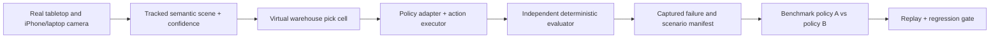
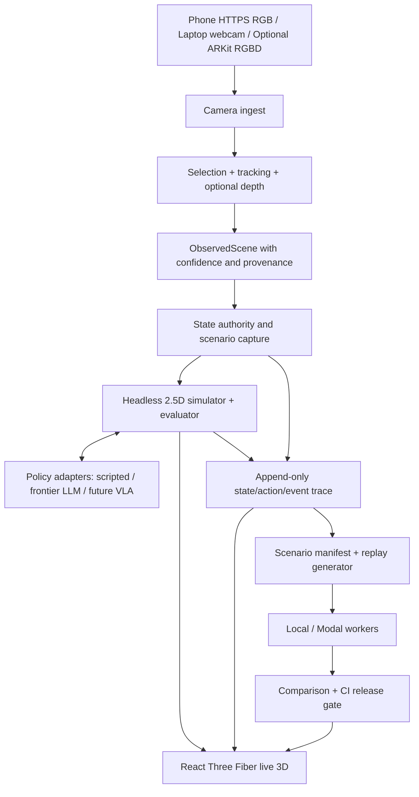

# FAULTLINE Pick — Product Requirements Document

**Version:** Hackathon release candidate v1.0  
**Date:** 17 October 2026  
**Industry wedge:** Warehouse bin picking / vision-guided manipulation  
**Product category:** Physical AI developer infrastructure; deployment-specific reliability evaluation  
**Working tagline:** **CI/CD for physical AI — turn real-world failures into regression tests.**  
**Deadline:** Submission by 16:00 local time on hack day  
**Hardware:** Laptops, webcams, and phones; everyday **unmarked** tabletop objects; no physical robot.

---

## 0. Executive decision

Build one end-to-end product workflow that is *real*, repeatable, visible and honest:

**Capture a tabletop workcell → synchronise a digital twin → run a virtual picking policy → physically disturb a real object → expose a policy failure → save a reproducible scenario → rerun another policy → show a release/regression result.**

The 3D digital twin, frontier-model reasoning and 100-scenario benchmark make that capability legible and impressive. They are not the central innovation by themselves.

### Non-negotiable positioning

FAULTLINE does **not** build a robotics foundation model, replace Isaac Lab, certify hardware safety, or claim real grasp success from a virtual gripper. Its proposed differentiation is **customer-specific physical failure capture, policy-agnostic scenario replay, evidence-backed comparisons, and CI-style release decisions**.

The first adopter hypothesis is a **robotics systems integrator or warehouse-picking robotics company** whose engineers repeatedly diagnose failures across deployments. The buyer and willingness to pay remain to be validated. Feedback from a technical robotics founder at the event indicates this is a problem worth solving, but does not constitute a purchase commitment.

---

## 1. Problem and why now

Robotic manipulation can perform well in controlled tests and deteriorate when objects shift, overlap, become occluded, or when a destination changes. Software updates can fix one failure and introduce others. Teams need to capture what happened, reproduce relevant conditions, and establish whether an updated policy actually improves performance before the next deployment.

Existing internal tools and major public frameworks *already* offer simulation benchmarks and policy evaluation, including NVIDIA Isaac Lab-Arena. A generic benchmark runner is therefore not a sufficiently differentiated product. The wedge is the path **from an unexpected event observed at the customer's physical site to a portable, versioned, replayable regression test**.

### Primary problem statement

> A robotics deployment engineer sees an unexpected object movement break a picking sequence, but cannot easily preserve the exact perception/policy/environment conditions, replay them after a software change, and produce a trustworthy release comparison.

### Desired customer outcome

Reduce engineer time from **physical failure → reproducible test → validated candidate fix**. Treat this as a commercial hypothesis, not a proven KPI.

### Target users

1. **Primary:** Robotics deployment / reliability / controls engineer at a bin-picking OEM or systems integrator.
2. **Secondary:** Robotics ML engineer comparing perception and planning policy changes.
3. **Economic buyer candidate:** Head of engineering, robotics solutions director, or industrial automation lead.
4. **Future users:** Site operations teams, procurement/acceptance engineers, and other physical autonomy sectors.

---

## 2. Industry scope

**In scope today:** One warehouse/industrial bin-picking workcell containing 3–5 unmarked objects; one picking task; an outbound destination; disturbances in visual/spatial state.

**Exemplary real objects:** Chocolate bar (parcel), small cardboard box (carton), highlighter/pen (slender SKU), water bottle (optional hard case); all reskinned with virtual industrial meshes. A paper or manually selected region may indicate the virtual outbound target. No fiducials or physical QR markers attached to items.

**Possible expansion:** Electronics assembly, wafer handling, airport ground equipment, maritime/autonomous vessels, construction/mining, agriculture. These are roadmap candidates requiring their own observation/action models and safety requirements; not supported by the MVP.

### Why this niche instead of general physical AI

- Precisely defined task completion: correct item moved into destination.
- Clear failure mechanisms: displacement, clutter, occlusion, obstruction, goal changes.
- Clear buyer workflow: developers update controllers and rerun regression tests.
- Credible tabletop prototype with existing hardware.
- Clear technical extension to robot API + simulation ecosystems.

---

## 3. Product story and north-star workflow

### The experience

1. User launches **Live Lab**, sees a live camera and 3D industrial twin.
2. Camera tracks selected objects; user labels them once and supplies approximate dimensions or confirms estimates.
3. User defines a task: e.g., *pick `chocolate_A` and put it into outbound bin*.
4. Robot policy obtains a **policy-limited** observation and chooses an allowed action.
5. A person moves the real chocolate bar while the virtual gripper is en route. The observation changes; the controller's previous belief may become stale.
6. Backend action executor applies a safety/validity rule and logs either a valid action or a specific error (`TARGET_DISPLACED`, `OBJECT_NOT_VISIBLE`, `PATH_OBSTRUCTED`, etc.).
7. A closed-loop model may re-observe, replan and complete the **simulated** task, or escalate appropriately.
8. User clicks **Create Regression Test**. FAULTLINE saves the initial workcell state, disturbance schedule/event, policy state/action trace, evaluator rules, and provenance.
9. User reruns this test against another policy/version in a fresh environment, not by merely rewatching the original video.
10. **CI Bench** presents results and a release gate. A policy can be blocked even when aggregate success improves if critical regressions appear.

### Three first-class product areas

- **Capture Lab:** live feed, object selection/tracking, scene calibration, optional depth, capture baseline, inject/record disturbance.
- **Robot Lab:** attractive warehouse cell, virtual Cartesian manipulator, visible model decisions/action validation/observations.
- **CI Bench:** versioned scenarios, batch evaluator, pass/fail tiles, real run metrics, failure inspector, baseline/candidate comparison, gate.

---

## 4. UX and interface requirements

### Screens

**Live Lab** — header shows session/camera/policy status, 2–3 column workspace: live RGB image with segmentation overlays; 3D cell centre-stage; policy trace, test settings and failure events right; event timeline below. Controls: Connect camera, Set workspace, Select object, Snapshot, Start run, Pause, Generate Regression Test.

**Scenario Inspector** — scenario family, captured source frame, initial state, disturbance type/trigger/severity, exact seed, controls, outcome criteria, playback of *recorded trace* and button **Rerun with candidate** (a fresh execution).

**CI Bench** — 10x10 grid of up to 100 seeded cases; each tile: pending/running/passed/failed/uncertain; filters by disturbance and policy; progress counts reflecting actual results; clickable comparisons and traces.

**Release Gate** — baseline/candidate policy manifest, actual case counts, wins/fixes/regressions, constraints, policy latency and model calls; explicit `PASS`, `BLOCK` or `INSUFFICIENT_EVIDENCE`. All metrics sourced from trace/evaluator, never invented.

### Visual requirements

- Premium industrial / developer-tooling look; clear typography, restrained bright/dark neutral colours, selective green/red statuses.
- Industrial 3D cell: worktable, inbound tote, outbound container, conveyor accent, robot/gripper, parcels, target route, gripper states, obstacle meshes and camera frustum if helpful.
- **Semantic reskinning:** real chocolate bar maps to a named rectangular shipping item; office carton to warehouse box; highlighter to slender package. Preserve tracked pose and approximate dimensions; do not infer physics from decorative GLBs.
- Continuous live updates with visible provenance: **REAL CAMERA**, **ESTIMATED POSE**, **SIMULATED ACTION**, **TEST RESULT**.
- On failure show the exact cause at the point of action, not just a generic red notification.
- Trace steps animate from logged transitions, never a hardcoded winning video.

### Success under live judging

A judge can move the unmarked object themselves and see a meaningful update, observe the simulator invalidate an action or choose recovery, then click a saved test and rerun it. No special robotics hardware required.

---

## 5. Functional requirements and priorities

| ID | Requirement | Priority | Acceptance |
|---|---|---|---|
| F01 | Capture phone or laptop RGB feed | P0 | Camera connects and feeds actual frames to app |
| F02 | Select/track >=3 distinct unmarked objects | P0 | Object identity and approximate pose update with physical movement; low confidence surfaced |
| F03 | Calibrate workspace plane and coordinate transforms | P0 | Real image coordinates map consistently into 3D tabletop |
| F04 | Shared scene-state contract with source + timestamp | P0 | Renderer, controller and evaluator reference same versioned state |
| F05 | 2.5D workcell and virtual manipulator | P0 | Executes at least one complete legal virtual pick-and-place |
| F06 | Policy adapter (scripted + frontier model) | P0 | Both receive policy-limited observation and return typed actions |
| F07 | Detect state change and reject stale/invalid action | P0 | Physical disturbance changes actual policy outcome/log |
| F08 | Capture complete trace and save a regression case | P0 | Test file persists and can be reloaded |
| F09 | Independently rerun a saved scenario | P0 | Fresh policy decisions/actions and new results generated |
| F10 | Policy comparison + CI release gate | P0 | Actual observed results and novel regressions surfaced |
| F11 | Procedural case generation (up to 100) | P1 | Saved seeds/definitions, genuine completion counts |
| F12 | Modal distributed worker execution | P1 | Deterministic cases run remotely and results aggregate faithfully |
| F13 | Optional iPhone ARKit RGB+LiDAR depth | P1/stretch | Optional depth metadata affects 3D confidence/height; RGB-only works unchanged |
| F14 | Jev image localization or failure classification | P1/stretch | Swappable detector/classifier; graceful fallback |
| F15 | Hyper3D generated GLBs | P2 | Cosmetic improvements; tested collider proxies unchanged |
| F16 | Export to LeRobot-like dataset schema / CI hook | P2 | Adapter proof with documented feature shapes and timestamps |

**Hard P0 success criterion:** A new physical perturbation becomes a saved case, is rerun in a fresh environment with two interchangeable controllers, and produces actual distinct results or a truthful no-difference outcome.

---

## 6. Camera, perception, calibration and optional LiDAR

### RGB-only mandatory path

1. Phone on a stable stand / chair / shelf, looking down at a contrasting table. Fixed exposure if possible.
2. Mobile **HTTPS** capture webpage uses `getUserMedia({video:{facingMode:'environment'},audio:false})` and sends periodic compressed frames over authenticated WSS, or local laptop `cv2.VideoCapture` feeds the same backend.
3. On desktop, operator clicks four corners of workspace and identifies 3–5 objects once using boxes/points; optionally uses SAM 2 to segment and track selected objects. Simple OpenCV colour/contour matching is acceptable for high-contrast objects.
4. Project 2D coordinates onto **calibrated planar workspace**. Four image corners alone provide normalized (u,v) positions; to get metric scale, enter one known real length (e.g., edge of an A4 sheet or manually measured tabletop span). Otherwise clearly label units normalized and use declared scene scale.
5. Update semantic objects at modest frame rate with smoothing/debounce, confidence, missing/occluded flags. Manual correction available.
6. Assign approximate `height_m` and collision footprint explicitly; never pretend one RGB camera measures full 3D or mass.

### LiDAR-capable iPhone optional path

Native **Swift + ARKit** companion app, because the standard Safari `getUserMedia()` path supplies RGB and does not expose ARKit `ARFrame.sceneDepth` or `smoothedSceneDepth` through a normal JavaScript camera stream.

- Requires a compatible LiDAR-equipped iPhone/iPad, Xcode/Swift expertise, camera permissions, local network/network transport permission as applicable, and successful device signing/install.
- `ARWorldTrackingConfiguration`; if `supportsFrameSemantics(.sceneDepth)` then enable `.sceneDepth` and optionally `.smoothedSceneDepth`.
- `ARSessionDelegate` obtains `ARFrame.capturedImage`, `ARFrame.sceneDepth?.depthMap`, `confidenceMap`, `ARCamera.intrinsics`, `ARCamera.transform`, frame time and tracking quality.
- Send either (a) RGB frames + compact depth tile/depth-at-object samples + calibration metadata, or (b) paired downsampled depth array with explicit dimensions, scale/encoding and frame association. Avoid full-resolution uncompressed streams during the hack.
- Back-project valid depth image pixels with camera intrinsics and transform into a shared world coordinate frame; estimate table plane; segment object pixels and measure relative height above plane/approximate XY dimensions. Invalid or low-confidence depth excluded.
- Because RGB/depth images have different resolutions and potentially different arrival characteristics, coordinate mapping, synchronization and rotation must be verified experimentally on the device.
- LiDAR does NOT grant guaranteed millimetre precision or reliable small/thin/transparent/shiny object measurements. Operator can override uncertain dimensions.
- The exact same scene-state stream is consumed downstream in RGB and RGBD modes. If bridge fails, use RGB-only immediately.

### Physical vs simulation state

Three distinct state domains must remain separate:

1. **Observed physical estimate:** what camera suggests, with sensor confidence.
2. **Simulator ground truth:** authoritative virtual object positions, gripper, collisions and goal status; not visible to the policy except through its permitted observation.
3. **Policy/controller belief:** what a model or controller currently thinks is true, which may become stale.

When gripper picks a virtual object, its transform becomes simulator-owned until released. Do not snap it to a still-present tabletop item. Physical updates continue for unheld items. In live demonstrations, synchronisation or authority conflicts must be logged.

---

## 7. Robot and policy requirements

### Environment contract

`reset(scenario_id, seed) -> observation`, `step(action) -> {observation,reward_or_score,terminated,truncated,info}`. Keep evaluation in an independent test engine and rendering separate.

### Policy contract

`reset(task, capabilities, version)` and `predict(observation) -> typed action or action chunk`. The adapter declares accepted sensor modalities, coordinate frames, action space, max rates, limits and required fields. Both scripted and frontier-model policies use the same environment adapter.

Two levels:

- **MVP high-level tools:** `OBSERVE`, `MOVE_TO`, `GRASP`, `PLACE`, `WAIT`, `REQUEST_HELP`, `DONE`; schema validated; executor checks reach, pose freshness, collision/obstruction, gripper and object state. This is a *symbolic/planning* policy test, not learned force control.
- **Future continuous robot actions:** end-effector delta/target, gripper command, joint-space action, action chunk, frames, frequency and safety envelope. LeRobot/ROS-style conventions preferred over arbitrary incompatible formats.

### Model selection

Frontier LLM (OpenAI or Anthropic) chooses high-level actions from bounded observation; no need to train a new model. Jev experimental image/bounding-box or typed classifier can be evaluated behind a flag; never sole source of object truth. Modal handles parallel workers after local test reliability. Hyper3D assets are cosmetics, not measured physics.

### Fair testing

Identical initial scene, disturbance definition, constraints and observation permissions. Do **not** provide a policy hidden simulator state or future perturbation schedule. Separate policy inference latency from simulated action time. For stochastic policies use repeat trials, track model/prompt/version/temperature/seed as appropriate, and never overstate determinism of remote model APIs.

---

## 8. Scenario suite: PickLab-100

Five families, 20 seeds each if time permits:

1. **Target displacement:** parcel moves after initial observation or at an action boundary.
2. **Visual occlusion:** partially/fully hide target; observation has masked pixels or explicit uncertainty based on perception pipeline.
3. **Workspace obstruction:** insert obstacle along path; legality depends on collider geometry.
4. **Clutter/ambiguity:** similar items, rotation, overlap, incorrect target selection risk.
5. **Destination change:** target zone relocates/blocks; replan or appropriate escalation.

Each saved case has stable ID, RNG seed, initial objects, geometry metadata, disturbance schedule, conditions/limits, policy observation modality and success predicate. Seeded simulation outcomes are reproducible; exact remote model actions may vary between invocations.

**Important demo accounting:** Display separately `(i) procedural scripted simulations`, `(ii) frontier-policy simulations`, and `(iii) live physical-capture trials`. Never aggregate differently sourced trials as if they were equally physical. Never label generated scenarios as completed runs until executed.

### Outcomes and metrics

- Task success/failure/unknown; correct-item placement.
- Constraint violations: wrong object, invalid grasp, collision, impossible plan or unsafe continuation.
- Re-observation/recovery attempts, elapsed time in simulator vs API wall time, actions per episode.
- New regressions (previously passed → now failed) and fixed failures (failed → now passed).
- Appropriate help/escalation when uncertainty or no safe plan exists.
- Test provenance: scenario hash, policy version, prompt hash, observation permissions, all trace events.

### CI gate

A release decision is configured per benchmark: require zero hard safety-rule violations; meet declared completion threshold on executed eligible tests; no critical regression; minimum test count. `INSUFFICIENT_EVIDENCE` is a valid outcome if too few completed cases or noisy tests.

---

## 9. Reference architecture

**Suggested stack:** React + TypeScript + Vite + Tailwind + React Three Fiber/Drei; FastAPI Python + WebSockets; OpenCV + optional segmentation; deterministic Python 2.5D simulator; SQLite + JSON/files for runs; Modal optional; frontier-model tool calling; optional native Swift ARKit sensor bridge. Assets from primitives first, Hyper3D GLB later.

### Reliability and privacy

- Frame timestamps and monotonic sequence IDs; rejected stale frames and bounded queues.
- No secret API keys in frontend or phone client; use server environment variables.
- Authenticated session token to pair camera to desktop session. Do not expose a public ingest endpoint unauthenticated.
- Capture only the consented tabletop, not random footage from the VC office; crop/blur surroundings if necessary.
- Local file recording as backup; camera/model/cloud disconnect should not erase the demo state.
- Failure-safe states: `CAMERA_DISCONNECTED`, `TRACKING_UNCERTAIN`, `DEPTH_UNAVAILABLE`, `POLICY_TIMEOUT`, `INSUFFICIENT_DATA`.
- Video and test logs have basic retention and deletion controls or local-only default.

---

## 10. Demo acceptance tests

**AT-1 Physical sync:** Selecting and moving a chocolate bar causes the corresponding virtual warehouse parcel to change pose, retaining identity in the normal lighting setup.

**AT-2 Valid controller:** A scripted policy completes one simulated pick-and-place with deterministic goal verification.

**AT-3 Disturbance:** Move the object after planning; an open-loop action fails for a logged, verifiable cause. The agent receives the resulting observation/error rather than being told an outcome in advance.

**AT-4 Recovery:** A recovery-enabled policy makes a fresh decision and attempts a valid course, or correctly asks for help.

**AT-5 Scenario persistence:** Button saves a meaningful scene snapshot + disturbance + controller/evaluator versions + timeline, and returns a case ID.

**AT-6 Fresh rerun:** Same case is recreated in a new simulation, and a second policy can execute its own actions. Recorded playback is displayed separately.

**AT-7 CI gate:** The dashboard accurately lists each actual completed test, including failures, new regressions and gate outcome; no invented numbers.

**AT-8 Resilience:** Disconnect the phone feed or model API; app displays fault state and can continue with laptop feed or prerecorded clearly labelled demonstration case.

**AT-9 Optional depth:** When native LiDAR connects, app shows depth availability and valid per-object metric estimates with confidence; disabling it does not affect other tests.

---

## 11. MVP milestones, team and prioritisation

**Hard cutoff:** 16:00. Reserve the final ~30–45 min for actual local screen recording, edits, repository/submission and recovery buffer.

**Engineering order (not independent silos):**

1. Share schemas and event names; one local state bus.
2. Run one headless pick-and-place with rule-based evaluator.
3. Render *the same* state in a 3D scene.
4. Camera captures and updates an unheld object's pose.
5. Run one actual frontier-model decision; validate typed action.
6. Cause one live physical disturbance and measure outcome.
7. Save it as scenario + fresh rerun.
8. Benchmark 10 cases, then 100 only if reliable.
9. Add optional LiDAR/Modal/Jev/Hyper3D without threatening steps 1–7.

**Suggested 4-way ownership:** A camera/perception, B simulator/policy, C frontend/3D, D scenario/CI + demo. With 3 members, D shares with B and C. One person owns API integration tests and overall merge.

**Strict fallback priority:** Phone depth → phone RGB → laptop RGB → saved camera recording (labelled replay). Hyper3D → primitive meshes. Modal → local executor. Experimental Jev → simple tracker or user click. Frontier model outage → clearly labelled scripted policy. Reduce scenario count before compromising truthful test outcomes.

---

## 12. Video and pitch

**60-second storyboard:**

- **0–7s:** "Robots pass demos. The world doesn't follow a script." Real tabletop + virtual robot.
- **7–18s:** Move the unmarked chocolate bar; corresponding 3D industrial parcel moves live.
- **18–32s:** Robot follows stale position → simulator rejects action; policy observes and replans.
- **32–44s:** Click "Create Regression Test"; show fresh rerun against candidate policy.
- **44–55s:** Genuine benchmark grid and one failure inspector; fix/regression comparison and gate.
- **55–60s:** "FAULTLINE — CI/CD for physical AI. Find the failure before deployment."

**Two-minute variant:** Add one new failure family, the policy adapter/observations diagram, and a side-by-side regression. Only use real results. Record locally, mix phone video with screen capture; no Wi-Fi-dependent final edit.

**Investor pitch:** "Robotics developers can test models in simulation, but deployment failures still depend on messy site-specific conditions. FAULTLINE captures those physical-world failures, converts them into reproducible scenarios, and runs updated robot policies through a common CI gate. We start with warehouse picking and expand across hardware stacks and deployment sites."

**Technical pitch:** "The capture adapter, policy adapter, simulator, oracle, event log and scenario runner are decoupled. No privileged ground truth leaks to the policy. The evaluator—not the LLM—decides outcomes. We currently use a simulated manipulator; the next validation is real robot policy and hardware replay."

---

## 13. Open questions, risks and explicit boundaries

- **Model-agnostic claim:** Can we actually demonstrate at least two adapters through identical contract? If not, say *adapter-ready architecture*.
- **Scene reconstruction:** RGB-only does not yield full metric 3D; LiDAR helps but remains approximate and may struggle with small, shiny or transparent items.
- **Policy comparison fairness:** Symbolic controller and VLA operate at different control levels. Do not claim equivalent low-level motion policies until tested.
- **Live-to-simulation mapping:** Physical objects remain physically present when a virtual robot picks them up; authority rules and state provenance must be explicit.
- **Sim-to-real evidence:** Neither 100 synthetic episodes nor virtual grasping establishes physical deployment readiness. Real robotic trials remain needed.
- **Differentiation:** NVIDIA Isaac Lab-Arena already includes benchmark authoring, scalable evaluation and analysis. We target automated real-site failure capture and repeatable deployment tests, but must continue competitive validation.
- **Business:** Ask OEM/integrator about painful recent failures, manual reproduction time, existing stack, acceptable adapter effort, budget authority, and reason to buy versus build.
- **Data and ethics:** Do not record bystanders or proprietary documents without permission. Keep recordings scoped to the demo tabletop.

---

## 14. Reference links (verified public documentation)

- Apple ARKit scene depth: https://developer.apple.com/documentation/arkit/arframe/scenedepth
- Apple ARDepthData and confidence: https://developer.apple.com/documentation/arkit/ardepthdata
- Apple point cloud from scene depth: https://developer.apple.com/documentation/arkit/displaying-a-point-cloud-using-scene-depth
- Apple ARCamera intrinsics / transform: https://developer.apple.com/documentation/arkit/arcamera
- Browser `getUserMedia` HTTPS requirement: https://developer.mozilla.org/en-US/docs/Web/API/MediaDevices/getUserMedia
- NVIDIA Isaac Lab-Arena: https://developer.nvidia.com/isaac/lab-arena
- Hugging Face LeRobot hardware integration: https://huggingface.co/docs/lerobot/main/integrate_hardware
- Hugging Face LeRobotDataset v3: https://huggingface.co/docs/lerobot/lerobot-dataset-v3
- Modal function map: https://modal.com/docs/sdk/py/latest/Function

**Document status:** Detailed product specification for a hackathon prototype; claims about physical reliability, certification, market demand and integration breadth require further testing.
